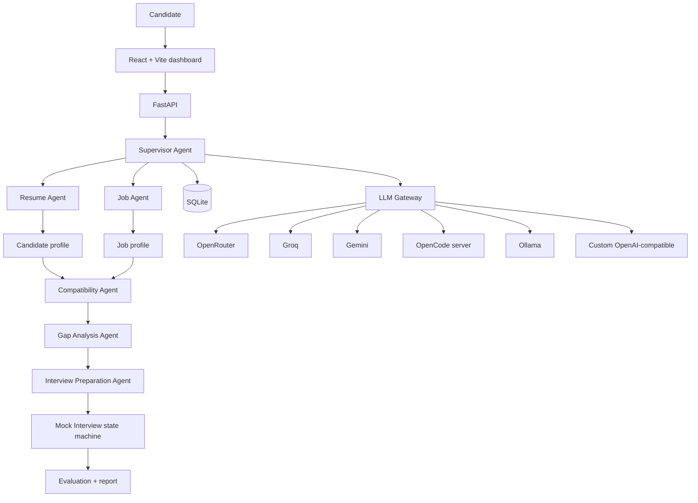

# RecruiMate — AI Career & Interview Coach

RecruiMate is a **candidate-side** AI preparation platform. Upload a resume, compare it with a real job
description, understand exactly which skills are missing, get a learning roadmap, and practise a scored mock
interview. It is **not** a recruiter ATS and never submits applications or contacts employers.


## What it does

| Module | Outcome |
| --- | --- |
| Resume intelligence | Extracts skills, experience, projects, education; flags weaknesses and concrete fixes |
| Job intelligence | Separates required vs preferred skills, responsibilities, experience and education |
| Compatibility | Explainable weighted score (skills 40%, experience 25%, projects 20%, education 10%, certs 5%) |
| Skill gap | Prioritised roadmap with topics, practice projects, effort estimates and task tracking |
| Interview prep | Technical, project, HR, behavioural and problem-solving questions with expected points |
| Mock interview | One question at a time, follow-ups, six-dimension scoring and a final report |
| Analytics | Compatibility trend, interview trend, repeated gaps, study progress |
| Settings | Provider/model selection, per-agent routing, health checks, usage logs, data deletion |

**Key differentiator:** it does not stop at “you are a 75% match”. It shows the evidence behind the number,
turns gaps into tasks, and measures whether your interviews improve.

## Architecture



The supervisor graph is built with **LangGraph** when available. If the optional package is missing, the exact
same DAG (resume + job in parallel → compatibility → gaps → interview → report) runs through an async fallback
orchestrator. The UI reports which engine was used.

### Agents

- **Resume Agent** – PDF/DOCX/TXT parsing + structured extraction; merges deterministic parsing with an LLM when one is configured, so a model cannot erase facts it missed.
- **Job Agent** – required/preferred split, responsibilities, education, minimum years, role category.
- **Compatibility Agent** – deliberately LLM-free. Deterministic weights plus embedding similarity. Every score has an explanation and evidence.
- **Gap Analysis Agent** – prioritised roadmap from a curated local knowledge base; never fabricates course links.
- **Interview Agent** – question bank + answer evaluation. LLM scores are blended 60/40 with deterministic checks and the weighted overall is always recomputed.
- **Supervisor** – typed shared state, parallel resume/job branches, bounded work, error capture and activity trace.

## Quickstart

### 1. Backend

```bash
cd backend
python3 -m venv .venv
# Reuse system numpy/scipy on constrained devices:
# python3 -m venv --system-site-packages .venv
source .venv/bin/activate
pip install -r requirements.txt
cp ../.env.example ../.env        # optional
uvicorn app.main:app --host 127.0.0.1 --port 8000 --reload
```

API docs: <http://127.0.0.1:8000/docs> · health: `/api/health`.

The app starts in **heuristic mode** with no API keys. Resume parsing, compatibility scoring, roadmaps and
basic mock interviews all work offline.

### 2. Frontend

```bash
cd frontend
npm install
npm run dev          # http://localhost:5173, proxies /api to :8000
```

For a single-service deployment:

```bash
cd frontend && npm run build
# FastAPI automatically serves frontend/dist at http://127.0.0.1:8000
```

### Large devices / Android Termux notes

- `pydantic-core` may compile from source on Termux; allow several minutes the first time.
- `sentence-transformers` is optional and heavy (PyTorch). The built-in hashed embedding backend is used when it
  is absent. Set `EMBEDDINGS_BACKEND=hashed` to skip the import attempt.
- `pypdf` handles text-based PDFs. Scanned PDFs need OCR and are rejected with a clear message.

## LLM providers

Configure providers in the **Settings** page (stored server-side) or through environment variables. Environment
values act as defaults; values saved in the UI take precedence.

| Provider | Endpoint | Credential |
| --- | --- | --- |
| Heuristic | none | none |
| OpenRouter | `https://openrouter.ai/api/v1` | API key |
| Groq | `https://api.groq.com/openai/v1` | API key |
| Gemini | Google Generative Language API | API key |
| OpenCode | `http://127.0.0.1:8080` | Basic auth password |
| Ollama | `http://127.0.0.1:11434/v1` | none |
| Custom | any approved OpenAI-compatible host | optional |

Recommended first integration: **OpenRouter**.

```env
OPENROUTER_API_KEY=your_key
OPENROUTER_BASE_URL=https://openrouter.ai/api/v1
OPENROUTER_MODEL=openrouter/free
```

Free variants are rate limited (OpenRouter documents limits such as 20 req/min and 50 req/day; check current
terms). RecruiMate does not silently fall back to a paid model: set `ALLOW_PAID_FALLBACK=false` (default) and mark
paid providers explicitly.

### OpenCode adapter

OpenCode is an **agent runtime**, not an OpenAI-compatible inference endpoint. The adapter uses its documented
session API:

1. `POST /session` — create a temporary session
2. `POST /session/{id}/message` — submit the prompt
3. Poll `GET /session/{id}/message` if the server responds asynchronously
4. `DELETE /session/{id}` — clean up

Start a restricted instance:

```bash
OPENCODE_SERVER_PASSWORD="your-secret" \
opencode serve --hostname 127.0.0.1 --port 8080
```

```env
OPENCODE_BASE_URL=http://127.0.0.1:8080
OPENCODE_USERNAME=opencode
OPENCODE_PASSWORD=your-secret
```

Do not give this instance access to uploaded resumes, arbitrary shell execution or unrelated tools. The adapter
sends a single text prompt and extracts assistant text only; it never calls `/v1/chat/completions`.

### Per-agent routing

Settings → **Agent routing** lets each agent use a different provider/model. For example, resume extraction on a
fast structured-output model and mock interviews on a stronger conversational model. Compatibility and gap
analysis ignore routing because they are deterministic.

## API

| Method | Endpoint | Purpose |
| --- | --- | --- |
| POST | `/api/resume/upload` | Upload and parse a resume |
| GET | `/api/resume/profile` | Latest candidate profile |
| DELETE | `/api/resume/{id}` | Delete resume + linked reports |
| POST | `/api/jobs/analyze` | Analyse pasted text or a public URL |
| POST | `/api/compatibility/analyze` | Deterministic compatibility + optional roadmap |
| GET | `/api/compatibility/{id}` | Retrieve a report |
| POST | `/api/analysis/run` | Full supervisor workflow |
| POST | `/api/skill-gaps/generate` | Generate roadmap from a report |
| PATCH | `/api/skill-gaps/tasks/{id}` | Track learning progress |
| POST | `/api/interviews/prep` | Generate a question bank |
| POST | `/api/interviews` | Start a mock session |
| POST | `/api/interviews/{id}/answer` | Submit one answer |
| POST | `/api/interviews/{id}/complete` | Finish early and report |
| GET | `/api/dashboard` | Dashboard aggregates |
| GET | `/api/analytics` | Trends, weak skills, preparation |
| GET/PUT | `/api/providers*` | Configuration, health, models, routing, usage |
| DELETE | `/api/account/data` | Delete all personal data |

All endpoints except `/api/health` require a bearer token **only if** `API_TOKEN` is set. Empty means trusted
local mode.

## Testing

```bash
cd backend
source .venv/bin/activate
pytest -q
```

Coverage includes resume/job parsing, skill aliases, deterministic scoring, roadmap generation, answer
evaluation, all gateway adapters with a fake transport, OpenCode session lifecycle, provider failures, API
end-to-end flows, database persistence and privacy deletion.

The test suite sets `EMBEDDINGS_BACKEND=hashed` and `DEFAULT_PROVIDER=heuristic`, so it needs no network or keys.

## Security & privacy

- Resumes and analyses are stored in local SQLite; uploaded files live under `backend/data/uploads` with
  restrictive permissions.
- API keys are stored server-side and returned only as a masked hint. They are never placed in browser storage.
- Provider selection is explicit; the UI warns before a paid provider is enabled.
- Job URLs are SSRF-checked: private/loopback/link-local/metadata addresses are rejected.
- Custom endpoints must be listed in `ALLOWED_CUSTOM_HOSTS`; official providers are pinned to official hosts.
- Resume text is truncated before external calls and never includes credentials.
- Mock evaluation ignores accent, appearance and protected characteristics by prompt and by design.
- `DELETE /api/account/data` and the Settings danger zone remove documents, credentials and history.
- The app does not submit applications, contact employers or invent qualifications.

## Project structure

```text
recruimate/
├── backend/
│   ├── app/
│   │   ├── main.py, config.py
│   │   ├── agents/          # 5 specialist agents + base
│   │   ├── gateway/         # adapters, manager, fallback policy
│   │   ├── graph/           # LangGraph state, nodes, supervisor
│   │   ├── services/        # parsing, embeddings, scoring, roadmap, interview
│   │   ├── api/             # resume, jobs, compatibility, gaps, interviews, providers, dashboard
│   │   ├── database/        # SQLAlchemy models
│   │   ├── prompts/         # provider-agnostic prompts
│   │   └── utils/           # SSRF-safe URL fetching
│   ├── tests/
│   └── data/                # SQLite + uploads (gitignored)
├── frontend/
│   └── src/
│       ├── pages/           # 8 pages
│       ├── components/      # layout, score cards, charts, chat, gateway UI
│       └── services/        # axios client + formatters
├── .env.example
├── docker-compose.yml
└── README.md
```

## Known limits

- Compatibility is only as good as the resume text. Scanned PDFs need OCR.
- The offline hashed embedding backend is lexical; sentence-transformers improves semantic matching but does not
  change the scoring weights.
- Free provider quotas can change without notice. The gateway surfaces errors and never hides a failed call.
- OpenCode server API versions differ; the adapter handles both direct-message and history-polling responses, but
  a highly customised server may need configuration adjustments.
- Scores are preparation feedback, not hiring decisions.

## Definition of done

- [x] Upload a resume and extract a structured profile
- [x] Analyze a job description or fetch a public posting
- [x] Receive an explainable compatibility report with matched/partial/missing skills
- [x] Identify skill gaps and generate a personalized roadmap
- [x] Generate role-specific interview questions
- [x] Complete a one-question-at-a-time mock interview with follow-ups
- [x] Receive performance feedback and track progress
- [x] Switch between OpenRouter, Groq, Gemini, OpenCode, Ollama and custom providers without touching agent code
- [x] Remain usable offline and when a provider fails
